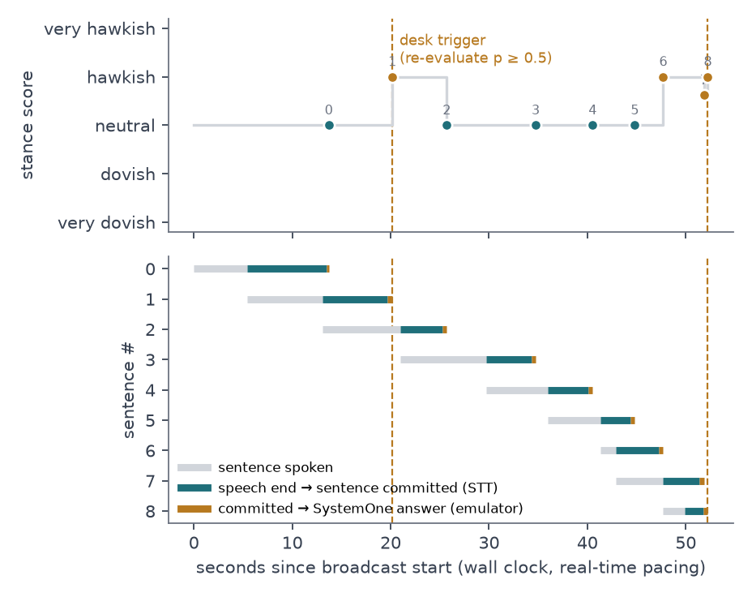
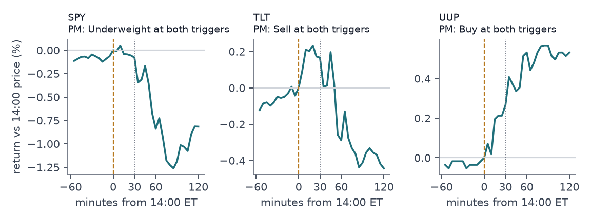
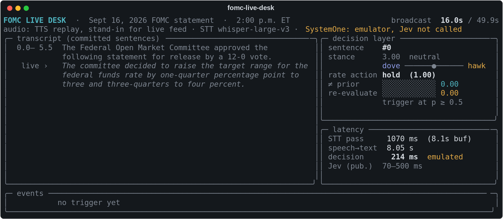
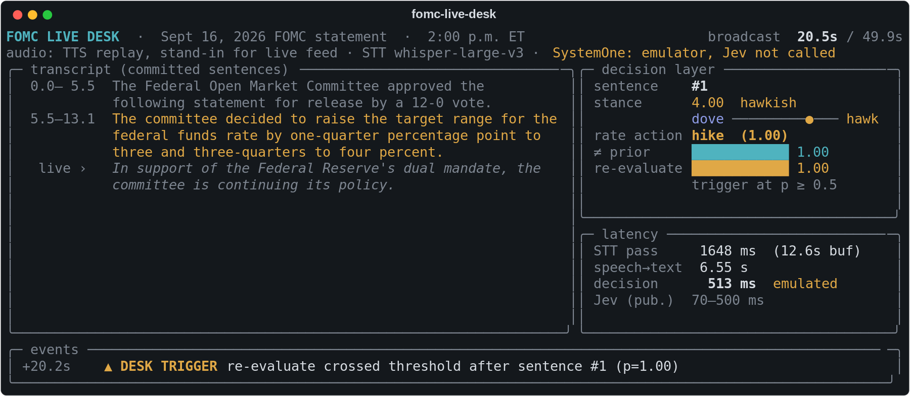
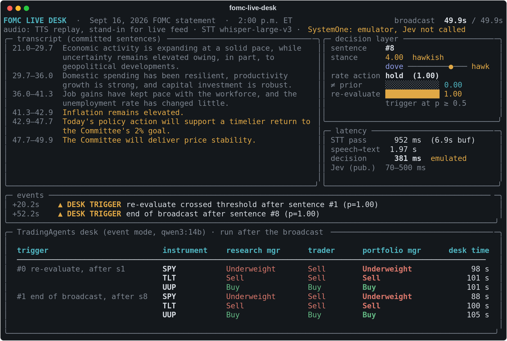

## Abstract

I built a pipeline that listens to a central-bank broadcast, turns it into complete sentences in real time, asks a fast
decision layer four fixed questions about each sentence, and calls a desk of LLM market participants when the
decision layer says positions should be re-evaluated. The desk is the open-source TradingAgents framework with a new
event-driven mode. On the 16 Sept 2026 FOMC statement (a 25 bp hike to 3-3/4–4 percent, 12–0), replayed through
text-to-speech, the streamed transcript reached 0.74% word error rate and each sentence was committed a median 4.3 s
after it was spoken. The decision layer is wired for TypeSafe's Jev model through the SystemOne API, but the run used a
local emulator on qwen3:14b; I state where this matters. The desk rated SPY Underweight, TLT Sell and UUP Buy at both
triggers. By the close all three ratings matched the sign of the move, while TLT moved against the call for the first
30 minutes. That is one event, so it shows the pipeline runs end to end, not that the agents can forecast.

## 1 Introduction

On FOMC days, prices move within seconds of the 2:00 p.m. release, before anyone has finished reading the statement.
In our lab I had used TradingAgents for stock recommendation, where a run takes minutes and works from daily data and
news. This project extends that work toward market simulation: what does a multi-agent desk do when its input is a
broadcast arriving sentence by sentence, and where does the time go?

The pipeline has five stages. (1) Audio: the published statement is read by macOS `say` and streamed from a wav at
broadcast speed; this stands in for a live feed, and an ffmpeg source for live URLs is implemented but was not tested
on a real stream. (2) Streamed STT with whisper-large-v3. (3) A decision layer in the SystemOne request format, which
returns probabilities over a fixed answer space instead of generated text. (4) A TradingAgents desk in event mode.
(5) A reaction report checked against realised 5-minute prices.

## 2 Method

### 2.1 Streaming transcription

Whisper is an offline model, so I re-transcribe the uncommitted audio buffer after every 1.5 s chunk and commit only
whole sentences. Let $h_k$ be the sentence list of the hypothesis after chunk $k$, and keep only the complete sentences
(a later sentence has started). Sentence $j$ is committed when both hypotheses contain it and their word sequences
nearly match:

$$
\text{commit}_j \iff \text{ratio}\big(h_k^{(j)}, h_{k-1}^{(j)}\big) \ge 0.8 \;\; \text{for all } j' \le j
\tag{1}
$$

where ratio is difflib's matching-block similarity on lower-cased word tokens. Exact matching failed because Whisper
switched between "one-quarter percentage point" and "0.25%" from one pass to the next. I locate the sentence end by
interpolating its character position inside Whisper's segment timestamps, then move it to the quietest 100 ms window
within ±0.5 s and cut the buffer there. The committed text is passed back as the decoder prompt. A buffer longer than
12 s commits its complete sentences without waiting for agreement.

### 2.2 Decision layer (SystemOne format)

Each committed sentence becomes one request `{model, state, questions}`. The state holds `segment`,
`transcript_so_far` and `prior_statement` (29 July 2026), and the questions refer to these fields in backticks. There
are four questions: `stance` (score, 1 very dovish … 5 very hawkish), `rate_action` (choice: hike/cut/hold/
not-in-segment), `change_vs_prior` (noul: yes/no) and `reprice` (noul: should a desk re-evaluate now?). Three backends
sit behind one interface: `JevBackend` (TypeSafe API, bearer key), `ClefBackend` (Cloudflare's open-weight Clef served
by SGLang on the same route), and `EmulatorBackend`. Jev and Clef are implemented and covered by mocked wire-format
tests, but neither was called: there is no key, and the Clef weights were not downloaded.

The emulator turns each question into a lettered list of options and forces a single-token answer from qwen3:14b with
thinking off. If $\ell_i$ is the next-token log-probability of option letter $i$, taken from the top-20 list (a missing
letter is set below the smallest listed value), then

$$
p_i = \frac{\exp(\ell_i)}{\sum_{m=1}^{M} \exp(\ell_m)}, \qquad
s = \sum_{i=1}^{5} i \, p_i , \qquad c = \max_i p_i
\tag{2}
$$

give the choice/score probabilities, the score $s$ (expected level on the legend) and the confidence $c$. Every
response is validated against the schema and carries `emulated: true`.

### 2.3 Trigger and desk

The desk is triggered on a rising edge of the re-evaluate probability, and once more at the end of the broadcast:

$$
\text{trigger}_t = \mathbb{1}\big[p^{\text{reprice}}_t \ge 0.5 \;\wedge\; p^{\text{reprice}}_{t-1} < 0.5\big]
\tag{3}
$$

The extension lives in `vendor/tradingagents/live/`. TradingAgents' four tool-calling data analysts are replaced by one
deterministic *Event Analyst* node. It makes no LLM call: it writes the transcript so far and the prior statement into
`news_report`, the per-sentence decision table and pre-event prices (closes to 15 Sept) into `market_report`, and a
description of the instrument into `fundamentals_report`. The original node factories then run unchanged: bull and bear
researchers (1 round), research manager, trader, aggressive/conservative/neutral risk analysts (1 round) and the
portfolio manager. The LLM comes from TradingAgents' own client factory (provider `ollama`, qwen3:14b, temperature 0,
thinking off, 600 output tokens). The instrument context sets the horizon to the rest of the session. Each trigger
stores a frozen snapshot, so the desk sees only what was known at that moment and never sees post-event prices.

## 3 Experiments

**Data.** The two statements come from federalreserve.gov. The audio is 49.9 s of `say -v Samantha -r 170`, read from a
spoken-form script ("one quarter", "3 and three quarters", "12 to 0"), because `say` reads "1/4" as "one slash four".
**Hardware.** felabworkstation, whisper-large-v3 fp16 on one RTX 3090, Ollama qwen3:14b (Q4_K_M, 32k context) on another.
Load average was 0.9 before the live run, 9.7–12.2 during the desk runs (other users) and about 1 for the latency
benchmark. **Metrics.** WER (Levenshtein over words, with basic and Whisper-normaliser variants), sentence lag
(commit time minus the end of the sentence's audio), decision latency, desk wall time, and realised returns from the
13:55 bar close (the last price before 14:00) using yfinance 5-minute bars. **Baselines.** For STT, an offline
single pass over the whole file. For the decision layer, Jev's published 70–500 ms, quoted but not measured.

## 4 Results

| measurement | value |
|---|---|
| WER streamed vs spoken script / vs published text (Whisper normaliser) | 0.74% / 2.24% |
| WER offline single pass, same two references | 0.74% / 2.24% |
| sentences committed (reference: 10) | 9 |
| Whisper pass, median / p95 (1.5 s chunks, 35 passes) | 923 ms / 1.47 s |
| sentence lag after speech, median / max | 4.28 s / 8.05 s |
| emulator request, live (questions in parallel) median / p95 | 419 / 487 ms |
| emulator request, quiet benchmark, sequential / parallel median | 282 / 280 ms |
| emulator single question, sequential median | 75 ms |

Streaming cost no accuracy: the streamed and offline transcripts have the same WER. The one structural error is
segmentation. Whisper moved a sentence boundary ("…four percent. In support of the dual mandate, the Committee is
continuing…") and joined two others, so 10 reference sentences became 9. Most of the 4.3 s lag comes from waiting for
two passes to agree, not from compute (compute RTF 0.66). The emulator answered a 4-question request in 0.28 s when
the server was quiet, which is inside Jev's published range. Sending the questions in parallel did not help, because
Ollama processes them one at a time.

The decision layer was decisive but often wrong. It labelled the hike sentence "hike" with confidence 1.00 and flagged
it as different from the prior statement (p = 1.00). It labelled every other sentence "hold" instead of
"not-in-segment" (1/9 correct), and it missed the change in the vote (9–3 to 12–0). Almost every probability was within
10⁻³ of 0 or 1. After the hike, `reprice` stayed at 1.00 for the rest of the statement, so rule (3) fired once, at
+20.2 s, and the end-of-broadcast trigger fired at +52.2 s.

| trigger | SPY (RM / trader / PM) | TLT | UUP | desk time |
|---|---|---|---|---|
| #0 after sentence 1 | Underweight / Sell / **Underweight** | Sell / Sell / **Sell** | Buy / Buy / **Buy** | 98–101 s each |
| #1 end of broadcast | Underweight / Sell / **Underweight** | Sell / Sell / **Sell** | Buy / Buy / **Buy** | 88–105 s each |

| realised return from 14:00 | +5 m | +30 m | +60 m | close |
|---|---|---|---|---|
| SPY | −0.01% | −0.08% | −0.84% | −0.82% |
| TLT | +0.09% | +0.17% | −0.29% | −0.44% |
| UUP | +0.07% | +0.27% | +0.53% | +0.53% |

The desk's views followed the textbook mapping: a hike is bad for equities and long bonds and good for the dollar.
By the close, all three ratings matched the sign of the move. At +30 minutes, TLT had rallied 0.17% against the Sell
call, and the larger moves came after the press conference began at 14:30, which the desk never heard. A fact check
also found invented details. The UUP trader and PM wrote an entry of 50.25 and a stop of 49.5, against a 28.22 close
they were given, and the UUP agents called the fund "leveraged" 28–35 times per run. The report flags these
automatically and uses only the ratings.

## 5 Limitations & next steps

- **Emulated pieces.** The audio is clean TTS, and Jev was never called. The emulator's near-binary probabilities make
  the 0.5 threshold almost meaningless. The first next step is to run the same requests against Jev or Clef-flash and
  compare calibration and latency on identical inputs.
- **One event.** Three instruments × two correlated triggers cannot test skill. The useful next experiment is a panel
  of past FOMC statements and press-conference audio, with ratings scored against moves measured in units of
  pre-event noise.
- **The desk is slow.** About 100 s per instrument means it would react after the first move. The desk ran after the
  broadcast; running it concurrently, with a smaller model for the debaters, is the obvious change.
- **The press conference matters.** Most of the move came after 14:30. The live mode should keep listening and
  re-trigger on Q&A.
- **Hallucinated levels.** The agents need the instrument's real price in a field they cannot ignore, or the price
  fields should be removed.

## A Progress log

**2026-10-15.** Fetched the prior statement. Wrote extraction, then synthesised audio. The first TTS read "1/4" as "one
slash four", so I added a spoken-form script. STT v1 committed Whisper segments: latency was fine, but the
unpunctuated short buffers produced one 39-second "sentence". v2 added a seeded decoder prompt, and Whisper then merged
the whole statement into one sentence. v3 used sentence agreement with word timestamps: the sentences were right, but
each pass took 3.3 s and the stream fell two minutes behind. v4 used segment timestamps with a pause snap and held real
time, but exact matching stalled for 17 s on a number rendered two ways. v5 used fuzzy agreement, and that is the run
reported here. Confirmed that Ollama returns top-logprobs with thinking off, which made the single-token emulator
possible. The vendored desk needed `langgraph-checkpoint-sqlite`. A TLT trial preceded the full 2 × 3 desk run. The
latency benchmark ran twice; the saved run is the one taken at load ≈1. The fact check of agent outputs was added after
I noticed the UUP price target. 28 tests pass on the server.
